# 全画面遷移図

すべての画面からホーム・全画面一覧・体験ガイドへ戻れます。下記は各画面固有の導線です。

```mermaid
flowchart LR
  dashboard["ホーム"]
  login["スタッフログイン"]
  business_open["営業開始"]
  business_status["営業状況"]
  business_close["営業終了"]
  business_history["営業履歴"]
  business_time["営業時刻の訂正"]
  customers["会員一覧・検索"]
  customer_new["名前だけの新規登録"]
  duplicate_check["同名会員の確認"]
  customer_detail["会員詳細"]
  customer_edit["会員情報の編集"]
  roster["紙・Excel名簿の照合"]
  visits["来店受付・来店中"]
  waiting["待機中の一覧"]
  checkout["退店処理"]
  tables["7卓の一覧"]
  table_seat["4人を卓に配置"]
  table_detail["対局中の卓"]
  member_change["1人を交代"]
  seat_swap["席替え"]
  game_start["次の半荘を始める"]
  game_entry["半荘結果入力"]
  game_confirm["結果確認・保存"]
  game_detail["対局結果の詳細"]
  game_history["対局履歴"]
  game_correct["結果を訂正"]
  performance["個人成績（店員用）"]
  ranking_month["月間ランキング"]
  ranking_year["年間ランキング"]
  ranking_all["通算ランキング"]
  ranking_settings["ランキング規定打数"]
  rules["成績計算ルール"]
  sales["売上・フリー本数"]
  table_sales["卓別の本数・売上"]
  day_sales["営業日別の本数・売上"]
  staff["スタッフ一覧"]
  staff_edit["スタッフ権限の編集"]
  staff_roles["権限の比較"]
  staff_sessions["スタッフセッション管理"]
  staff_play["スタッフの対局参加"]
  staff_games["スタッフ成績・参加本数"]
  duty["番責の指定"]
  loans["アウト・前貸し"]
  cashback["スタッフのゲーム代バック"]
  shifts["店舗内の勤務記録"]
  expenses["経費管理"]
  cash["現金管理"]
  inventory["在庫管理"]
  stock_move["在庫の増減"]
  report["営業日報"]
  exports["Excel・CSV出力"]
  store_settings["店舗・デモ設定"]
  sets["セット利用一覧"]
  set_new["セット利用受付"]
  set_detail["セット利用の詳細・終了"]
  reservations["予約一覧"]
  reservation_new["予約登録・変更"]
  reservation_detail["予約詳細"]
  public_ranking["一般公開ランキング"]
  public_profile["公開プロフィール"]
  member_home["会員マイページ"]
  member_stats["自分の成績"]
  member_history["自分の対局履歴"]
  member_points["自分の保有ポイント"]
  member_point_history["ポイント獲得・利用履歴"]
  member_qr["会員QR表示"]
  member_login["会員の本人確認"]
  member_link["スマホ初回連携"]
  member_passkey["パスキー認証の体験"]
  member_recovery["認証情報の復旧"]
  member_privacy["公開・非公開設定"]
  opponent_history["対戦相手の表示案"]
  points["特典ポイント管理"]
  point_adjust["ポイント調整・取消"]
  point_redemption["特典交換・現金バック"]
  point_migrate["旧LINEポイントの引継ぎ"]
  point_migrations["ポイント移行履歴"]
  point_yakuman["役満の記録"]
  point_rules["ポイント付与ルール"]
  qr["QR受付の体験"]
  qr_arrival["来店時QRパターン"]
  qr_counter["退店時カウンターQR"]
  qr_compare["QR受付2方式の比較"]
  line_options["LINE・ポイントの2案"]
  line_shopcard["案A：LINEショップカード継続"]
  line_link["案B：LINE本人識別＋独自ポイント"]
  cloud["Neon・VercelとAWSの比較"]
  all_screens["全画面一覧・検索"]
  sitemap["全画面遷移図"]
  demo_guide["営業フローを通して体験"]
  explain["関係者向け説明モード"]
  roadmap["今後の開発計画"]
  issues["導入までの課題"]
  launch_checklist["導入前チェックリスト"]
  audit["操作履歴"]
  dashboard --> business_status
  dashboard --> visits
  dashboard --> tables
  dashboard --> sales
  login --> dashboard
  business_open --> business_status
  business_open --> visits
  business_status --> business_close
  business_status --> tables
  business_status --> visits
  business_close --> business_history
  business_history --> day_sales
  business_history --> business_time
  business_time --> business_history
  customers --> customer_detail
  customers --> customer_new
  customers --> roster
  customer_new --> duplicate_check
  customer_new --> visits
  duplicate_check --> customer_detail
  duplicate_check --> customer_new
  customer_detail --> customer_edit
  customer_detail --> performance
  customer_detail --> points
  customer_detail --> member_link
  customer_edit --> customer_detail
  roster --> customers
  roster --> point_migrate
  visits --> waiting
  visits --> tables
  visits --> checkout
  waiting --> table_seat
  waiting --> visits
  checkout --> qr_counter
  checkout --> business_close
  tables --> table_seat
  tables --> table_detail
  tables --> sets
  table_seat --> table_detail
  table_detail --> game_entry
  table_detail --> member_change
  table_detail --> seat_swap
  table_detail --> game_history
  member_change --> table_detail
  seat_swap --> table_detail
  game_start --> game_entry
  game_entry --> game_confirm
  game_confirm --> game_detail
  game_confirm --> game_start
  game_detail --> game_correct
  game_detail --> performance
  game_detail --> table_detail
  game_history --> game_detail
  game_correct --> game_detail
  game_correct --> sales
  performance --> game_history
  performance --> customer_detail
  ranking_month --> ranking_year
  ranking_month --> ranking_all
  ranking_month --> ranking_settings
  ranking_year --> ranking_month
  ranking_year --> ranking_all
  ranking_all --> ranking_month
  ranking_settings --> ranking_month
  rules --> game_entry
  sales --> table_sales
  sales --> day_sales
  table_sales --> sales
  table_sales --> tables
  day_sales --> business_history
  day_sales --> sales
  staff --> staff_edit
  staff --> staff_roles
  staff --> staff_play
  staff_edit --> staff
  staff_roles --> login
  staff_roles --> staff_sessions
  staff_sessions --> staff
  staff_play --> table_seat
  staff_play --> staff_games
  staff_games --> cashback
  duty --> report
  duty --> cash
  loans --> cash
  loans --> report
  cashback --> staff_games
  cashback --> cash
  shifts --> staff
  shifts --> report
  expenses --> cash
  expenses --> report
  cash --> expenses
  cash --> loans
  cash --> report
  inventory --> stock_move
  inventory --> report
  stock_move --> inventory
  report --> exports
  report --> cash
  exports --> report
  store_settings --> rules
  store_settings --> ranking_settings
  sets --> set_new
  sets --> set_detail
  sets --> reservations
  set_new --> set_detail
  set_detail --> sets
  set_detail --> sales
  reservations --> reservation_new
  reservations --> reservation_detail
  reservation_new --> reservations
  reservation_detail --> set_new
  reservation_detail --> reservations
  public_ranking --> public_profile
  public_ranking --> member_login
  public_profile --> public_ranking
  member_home --> member_stats
  member_home --> member_history
  member_home --> member_points
  member_home --> member_qr
  member_stats --> member_history
  member_history --> opponent_history
  member_history --> member_stats
  member_points --> member_point_history
  member_point_history --> member_points
  member_qr --> qr_counter
  member_qr --> member_home
  member_login --> member_passkey
  member_login --> line_link
  member_link --> member_passkey
  member_passkey --> member_home
  member_passkey --> member_recovery
  member_recovery --> member_login
  member_privacy --> public_ranking
  member_privacy --> member_home
  opponent_history --> member_history
  points --> point_adjust
  points --> point_redemption
  points --> point_migrate
  point_adjust --> points
  point_redemption --> member_points
  point_redemption --> cash
  point_migrate --> point_migrations
  point_migrations --> point_migrate
  point_yakuman --> points
  point_rules --> qr_compare
  point_rules --> points
  qr --> qr_arrival
  qr --> qr_counter
  qr --> qr_compare
  qr_arrival --> visits
  qr_arrival --> tables
  qr_counter --> point_migrate
  qr_counter --> checkout
  qr_compare --> qr_arrival
  qr_compare --> qr_counter
  line_options --> line_shopcard
  line_options --> line_link
  line_options --> point_migrate
  line_shopcard --> line_options
  line_shopcard --> visits
  line_link --> qr_arrival
  line_link --> member_home
  cloud --> issues
  cloud --> launch_checklist
  all_screens --> sitemap
  all_screens --> explain
  sitemap --> all_screens
  demo_guide --> login
  demo_guide --> business_open
  demo_guide --> visits
  demo_guide --> tables
  explain --> roadmap
  explain --> issues
  roadmap --> issues
  roadmap --> launch_checklist
  issues --> cloud
  issues --> launch_checklist
  launch_checklist --> issues
  launch_checklist --> report
  audit --> business_history
```

- [ホーム](../index.html#/dashboard) → 営業状況／来店受付・来店中／7卓の一覧／売上・フリー本数
- [スタッフログイン](../index.html#/login) → ホーム
- [営業開始](../index.html#/business-open) → 営業状況／来店受付・来店中
- [営業状況](../index.html#/business-status) → 営業終了／7卓の一覧／来店受付・来店中
- [営業終了](../index.html#/business-close) → 営業履歴
- [営業履歴](../index.html#/business-history) → 営業日別の本数・売上／営業時刻の訂正
- [営業時刻の訂正](../index.html#/business-time) → 営業履歴
- [会員一覧・検索](../index.html#/customers) → 会員詳細／名前だけの新規登録／紙・Excel名簿の照合
- [名前だけの新規登録](../index.html#/customer-new) → 同名会員の確認／来店受付・来店中
- [同名会員の確認](../index.html#/duplicate-check) → 会員詳細／名前だけの新規登録
- [会員詳細](../index.html#/customer-detail) → 会員情報の編集／個人成績（店員用）／特典ポイント管理／スマホ初回連携
- [会員情報の編集](../index.html#/customer-edit) → 会員詳細
- [紙・Excel名簿の照合](../index.html#/roster) → 会員一覧・検索／旧LINEポイントの引継ぎ
- [来店受付・来店中](../index.html#/visits) → 待機中の一覧／7卓の一覧／退店処理
- [待機中の一覧](../index.html#/waiting) → 4人を卓に配置／来店受付・来店中
- [退店処理](../index.html#/checkout) → 退店時カウンターQR／営業終了
- [7卓の一覧](../index.html#/tables) → 4人を卓に配置／対局中の卓／セット利用一覧
- [4人を卓に配置](../index.html#/table-seat) → 対局中の卓
- [対局中の卓](../index.html#/table-detail) → 半荘結果入力／1人を交代／席替え／対局履歴
- [1人を交代](../index.html#/member-change) → 対局中の卓
- [席替え](../index.html#/seat-swap) → 対局中の卓
- [次の半荘を始める](../index.html#/game-start) → 半荘結果入力
- [半荘結果入力](../index.html#/game-entry) → 結果確認・保存
- [結果確認・保存](../index.html#/game-confirm) → 対局結果の詳細／次の半荘を始める
- [対局結果の詳細](../index.html#/game-detail) → 結果を訂正／個人成績（店員用）／対局中の卓
- [対局履歴](../index.html#/game-history) → 対局結果の詳細
- [結果を訂正](../index.html#/game-correct) → 対局結果の詳細／売上・フリー本数
- [個人成績（店員用）](../index.html#/performance) → 対局履歴／会員詳細
- [月間ランキング](../index.html#/ranking-month) → 年間ランキング／通算ランキング／ランキング規定打数
- [年間ランキング](../index.html#/ranking-year) → 月間ランキング／通算ランキング
- [通算ランキング](../index.html#/ranking-all) → 月間ランキング
- [ランキング規定打数](../index.html#/ranking-settings) → 月間ランキング
- [成績計算ルール](../index.html#/rules) → 半荘結果入力
- [売上・フリー本数](../index.html#/sales) → 卓別の本数・売上／営業日別の本数・売上
- [卓別の本数・売上](../index.html#/table-sales) → 売上・フリー本数／7卓の一覧
- [営業日別の本数・売上](../index.html#/day-sales) → 営業履歴／売上・フリー本数
- [スタッフ一覧](../index.html#/staff) → スタッフ権限の編集／権限の比較／スタッフの対局参加
- [スタッフ権限の編集](../index.html#/staff-edit) → スタッフ一覧
- [権限の比較](../index.html#/staff-roles) → スタッフログイン／スタッフセッション管理
- [スタッフセッション管理](../index.html#/staff-sessions) → スタッフ一覧
- [スタッフの対局参加](../index.html#/staff-play) → 4人を卓に配置／スタッフ成績・参加本数
- [スタッフ成績・参加本数](../index.html#/staff-games) → スタッフのゲーム代バック
- [番責の指定](../index.html#/duty) → 営業日報／現金管理
- [アウト・前貸し](../index.html#/loans) → 現金管理／営業日報
- [スタッフのゲーム代バック](../index.html#/cashback) → スタッフ成績・参加本数／現金管理
- [店舗内の勤務記録](../index.html#/shifts) → スタッフ一覧／営業日報
- [経費管理](../index.html#/expenses) → 現金管理／営業日報
- [現金管理](../index.html#/cash) → 経費管理／アウト・前貸し／営業日報
- [在庫管理](../index.html#/inventory) → 在庫の増減／営業日報
- [在庫の増減](../index.html#/stock-move) → 在庫管理
- [営業日報](../index.html#/report) → Excel・CSV出力／現金管理
- [Excel・CSV出力](../index.html#/exports) → 営業日報
- [店舗・デモ設定](../index.html#/store-settings) → 成績計算ルール／ランキング規定打数
- [セット利用一覧](../index.html#/sets) → セット利用受付／セット利用の詳細・終了／予約一覧
- [セット利用受付](../index.html#/set-new) → セット利用の詳細・終了
- [セット利用の詳細・終了](../index.html#/set-detail) → セット利用一覧／売上・フリー本数
- [予約一覧](../index.html#/reservations) → 予約登録・変更／予約詳細
- [予約登録・変更](../index.html#/reservation-new) → 予約一覧
- [予約詳細](../index.html#/reservation-detail) → セット利用受付／予約一覧
- [一般公開ランキング](../index.html#/public-ranking) → 公開プロフィール／会員の本人確認
- [公開プロフィール](../index.html#/public-profile) → 一般公開ランキング
- [会員マイページ](../index.html#/member-home) → 自分の成績／自分の対局履歴／自分の保有ポイント／会員QR表示
- [自分の成績](../index.html#/member-stats) → 自分の対局履歴
- [自分の対局履歴](../index.html#/member-history) → 対戦相手の表示案／自分の成績
- [自分の保有ポイント](../index.html#/member-points) → ポイント獲得・利用履歴
- [ポイント獲得・利用履歴](../index.html#/member-point-history) → 自分の保有ポイント
- [会員QR表示](../index.html#/member-qr) → 退店時カウンターQR／会員マイページ
- [会員の本人確認](../index.html#/member-login) → パスキー認証の体験／案B：LINE本人識別＋独自ポイント
- [スマホ初回連携](../index.html#/member-link) → パスキー認証の体験
- [パスキー認証の体験](../index.html#/member-passkey) → 会員マイページ／認証情報の復旧
- [認証情報の復旧](../index.html#/member-recovery) → 会員の本人確認
- [公開・非公開設定](../index.html#/member-privacy) → 一般公開ランキング／会員マイページ
- [対戦相手の表示案](../index.html#/opponent-history) → 自分の対局履歴
- [特典ポイント管理](../index.html#/points) → ポイント調整・取消／特典交換・現金バック／旧LINEポイントの引継ぎ
- [ポイント調整・取消](../index.html#/point-adjust) → 特典ポイント管理
- [特典交換・現金バック](../index.html#/point-redemption) → 自分の保有ポイント／現金管理
- [旧LINEポイントの引継ぎ](../index.html#/point-migrate) → ポイント移行履歴
- [ポイント移行履歴](../index.html#/point-migrations) → 旧LINEポイントの引継ぎ
- [役満の記録](../index.html#/point-yakuman) → 特典ポイント管理
- [ポイント付与ルール](../index.html#/point-rules) → QR受付2方式の比較／特典ポイント管理
- [QR受付の体験](../index.html#/qr) → 来店時QRパターン／退店時カウンターQR／QR受付2方式の比較
- [来店時QRパターン](../index.html#/qr-arrival) → 来店受付・来店中／7卓の一覧
- [退店時カウンターQR](../index.html#/qr-counter) → 旧LINEポイントの引継ぎ／退店処理
- [QR受付2方式の比較](../index.html#/qr-compare) → 来店時QRパターン／退店時カウンターQR
- [LINE・ポイントの2案](../index.html#/line-options) → 案A：LINEショップカード継続／案B：LINE本人識別＋独自ポイント／旧LINEポイントの引継ぎ
- [案A：LINEショップカード継続](../index.html#/line-shopcard) → LINE・ポイントの2案／来店受付・来店中
- [案B：LINE本人識別＋独自ポイント](../index.html#/line-link) → 来店時QRパターン／会員マイページ
- [Neon・VercelとAWSの比較](../index.html#/cloud) → 導入までの課題／導入前チェックリスト
- [全画面一覧・検索](../index.html#/all-screens) → 全画面遷移図／関係者向け説明モード
- [全画面遷移図](../index.html#/sitemap) → 全画面一覧・検索
- [営業フローを通して体験](../index.html#/demo-guide) → スタッフログイン／営業開始／来店受付・来店中／7卓の一覧
- [関係者向け説明モード](../index.html#/explain) → 今後の開発計画／導入までの課題
- [今後の開発計画](../index.html#/roadmap) → 導入までの課題／導入前チェックリスト
- [導入までの課題](../index.html#/issues) → Neon・VercelとAWSの比較／導入前チェックリスト
- [導入前チェックリスト](../index.html#/launch-checklist) → 導入までの課題／営業日報
- [操作履歴](../index.html#/audit) → 営業履歴
